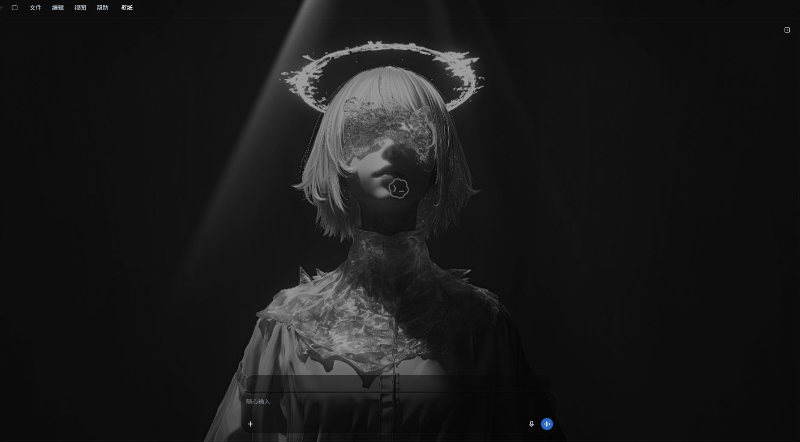

# Codex Wallpaper Bridge

[简体中文](README.md)

A local wallpaper layer for the Codex desktop app on Windows. Pick static images or animated videos inside Codex, browse installed Wallpaper Engine libraries, and adjust playback quality without restarting the client.

This is an independent community project, not an official OpenAI plugin. It connects through the local Chromium debugging interface. No accounts, wallpaper source files, or user configuration are included.



See the [Chinese screenshot gallery](README.md#效果展示) and [capture provenance](docs/SCREENSHOTS.zh-CN.md) for all 11 actual desktop captures. Private fields were hidden before capture; the gallery uses self-made sample thumbnails. No chat transcript or desktop/taskbar is shown. The visible third-party wallpaper remains its author's work and is not licensed by this repository's code license.

## Features

- Sandboxed WebGL scenes and native scene/web capture, with confirmation, save-only references and failure recovery. See [WebGL](docs/WEBWALLGL.md) and [realtime mode](docs/REALTIME.md).
- The 4K tier renders at 3840×2160. GPU scenes reuse the DSH v1.4.0 renderer control source; native capture uses the installed Wallpaper Engine and follows its desktop frame-rate cap.
- Opt-in [headless Chromium Web source (experimental)](docs/BROWSER-WEB-20261027.zh-CN.md), using local Chrome/Edge, project-relative assets and partial WE APIs. Pause releases its browser; resume reloads the page.
- Paged thumbnails, type/rating filters, hide/restore, portable appearance presets, saved media/GPU/native-project rotation, glass, fonts, parallax and click/trail FX.
- Optional [system media](docs/SYSTEM-MEDIA.md), off by default.
- Resize the embedded settings panel from its lower-right grip; drag its title, remember its size, or reset it. No separate window.

- In-app wallpaper library, local imports, switching, and deletion of app-owned copies.
- Default search limited to discovered Wallpaper Engine libraries across local disks, including Workshop, custom projects, and built-in projects.
- Optional folder search for Wallpaper projects or ordinary images/videos.
- Wallpaper-derived colors across the chat, sidebar, and common settings surfaces.
- Separate message and composer space to keep transparent input controls readable.
- Silent video playback, pause on loss of focus, adjustable resolution/frame limits, and hot application after conversion.
- One current playback file per wallpaper; previous playback copies are replaced after successful decode.
- Optional hidden Windows launcher. Its build uses the locally installed client icon; no OpenAI icon is redistributed.

## Requirements

- Windows 10/11, x64, with the official Microsoft Store Codex client installed.
- Node.js 22 or later and PowerShell 7.
- FFmpeg with H.264 and WebP encoders, supplied separately. Set `CODEX_WALLPAPER_FFMPEG` if it is not on PATH or discoverable from a local WinGet installation.
- Wallpaper Engine only for Wallpaper Engine library features. Local image/video imports do not require it.
- .NET Framework C# compiler for the optional GUI launcher.

There are no production npm dependencies. The required parsing and Windows helper sources are vendored with their original licenses; see [third-party notices](THIRD_PARTY_NOTICES.md).

## Setup

1. Review [security](SECURITY.md) and [privacy](PRIVACY.md).
2. Ensure `node.exe`, `pwsh.exe`, and FFmpeg are available. Optional overrides are documented in [configuration](docs/CONFIGURATION.md).
3. In PowerShell 7, from this checkout:

   ```powershell
   ./windows/Build-Launcher.ps1
   ./windows/Prepare-TaskbarEntry.ps1
   ```

4. The scripts create `CodexEntry.exe` and `Codex.lnk` under `%LOCALAPPDATA%\CodexWallpaperBridge`, or your configured data directory. They do not replace existing desktop shortcuts or taskbar pins. If the checkout moves, rebuild the launcher.
5. Before first use, save drafts and fully exit the ordinary Codex client yourself. Open the generated shortcut to start a local debugging session and load the wallpaper controls.
6. If desired, manually replace an old taskbar pin with this generated shortcut. A shared icon/AppID does not redirect an existing Store pin.

For GPU scenes, run `npm run prepare:webwallgl` with the same data-directory configuration. Optional system media uses `npm run prepare:media` and requires a working GitHub CLI. See [WebGL setup](docs/WEBWALLGL.md) and [system media](docs/SYSTEM-MEDIA.md). Chromium Web mode requires local Chrome/Edge; native capture requires Wallpaper Engine.

For a local Codex debugging session started through the unified entry, `npm start` attaches the host to loopback port 9335. It does not enable debugging on an ordinary running client. Do not expose the port to a network.

## Use

Open **壁纸** in the client. The current UI is in Chinese.

- **搜索 Wallpaper 壁纸 / 图片 / 视频** defaults to Wallpaper Engine + discovered global libraries. Change to a folder to search a particular project/library.
- **其它图片 / 视频** searches a chosen folder and its descendants. It does not scan every image/video on every drive by default.
- My-library selection previews a thumbnail and renderer label; apply and delete are explicit buttons. Selected import inspection stays beside its preview.
- Checked imports save the whole selection without changing the active background. Duplicate items prompt or appear in a batch summary; file content hashes distinguish renamed copies from changed contents.
- Choose a result and import it. Direct imports accept JPG, PNG, WebP, GIF, MP4, and WebM, subject to size/format limits.
- Choose resolution and FPS, then apply. Conversion takes time; the host switches after decoding the new copy. Default: 1280-wide, 24 FPS, muted, pause in the background. High settings and large sources can still cost CPU/GPU time.
- Delete removes app-owned records and unreferenced app copies, never Workshop or external source files.

Auto mode prefers complete GPU scenes and original Wallpaper Engine capture for Web projects. An explicit experimental Chromium Web mode is also available. Scene scripts and effects have project-dependent compatibility. See [WebGL](docs/WEBWALLGL.md), [native capture](docs/REALTIME.md) and [Chromium Web](docs/BROWSER-WEB-20261027.zh-CN.md) for mode-specific behavior.

## Development

```text
src/        Host, local actions, UI styling, discovery and conversion
windows/    Launcher source, build/setup scripts and folder picker
vendor/     Minimal third-party source and unchanged licenses
test/       Synthetic tests; no personal wallpaper or conversation fixtures
tools/      Release allowlist, content and checksum checks
docs/       Configuration, architecture, validation and release checklist
```

```powershell
npm test
npm run check:privacy
# Optional: local Chrome/Chromium + FFmpeg, isolated synthetic page only
npm run test:integration
```

No tests should attach to a real Codex session or copy a real account profile. The integration test uses a temporary isolated browser profile and generated media. Test reports are local; do not publish real client logs or screenshots without reviewing them.

## License and acknowledgements

See [LICENSE](LICENSE) for original code and [THIRD_PARTY_NOTICES.md](THIRD_PARTY_NOTICES.md) for upstream notices. Wallpapers and proprietary client software are not part of the code license. OpenAI, Codex, Steam, and Wallpaper Engine names belong to their respective owners; no affiliation is implied.
