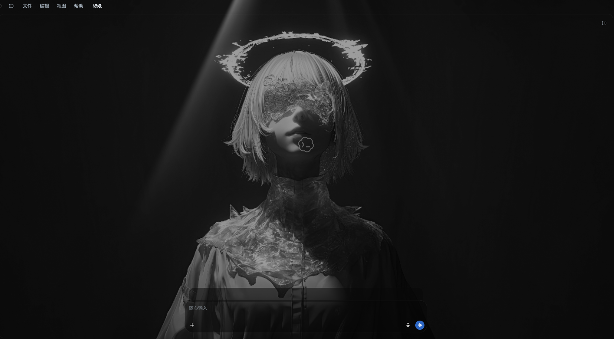

# Codex Wallpaper Bridge

[简体中文](README.md)

A local wallpaper layer for the Codex desktop app on Windows. Pick static images or animated videos inside Codex, browse installed Wallpaper Engine libraries, and adjust playback quality without restarting the client.

This is an independent community project, not an official OpenAI plugin. It connects through the local Chromium debugging interface. No accounts, wallpaper source files, or user configuration are included.



See the [Chinese screenshot gallery](README.md#效果展示) and [capture provenance](docs/SCREENSHOTS.zh-CN.md) for all 11 actual desktop captures. Private fields were hidden before capture; the gallery uses self-made sample thumbnails. No chat transcript or desktop/taskbar is shown. The visible third-party wallpaper remains its author's work and is not licensed by this repository's code license.

## Features

- Sandboxed WebGL scenes and native scene/web capture, with confirmation, save-only references and failure recovery. See [WebGL](docs/WEBWALLGL.md) and [realtime mode](docs/REALTIME.md).
- The 4K tier renders at 3840×2160. GPU scenes reuse the DSH v1.4.0 renderer control source; native capture uses the installed Wallpaper Engine and follows its desktop frame-rate cap.
- Opt-in [headless Chromium Web source (experimental)](docs/BROWSER-WEB-20261027.zh-CN.md), using local Chrome/Edge, project-relative assets and partial WE APIs. Pause releases its browser; resume reloads the page.
- Paged thumbnails, type/rating filters, hide/restore, portable appearance presets, saved media/GPU/native-project rotation, glass, fonts, parallax and click/trail FX.
- Optional [system media](docs/SYSTEM-MEDIA.md), off by default.
- Resize the embedded settings panel from its lower-right grip; drag its title, remember its size, or reset it. No separate window.

- In-app wallpaper library, local imports, switching, and deletion of app-owned copies.
- Default search limited to discovered Wallpaper Engine libraries across local disks, including Workshop, custom projects, and built-in projects.
- Optional folder search for Wallpaper projects or ordinary images/videos.
- Wallpaper-derived colors across the chat, sidebar, and common settings surfaces.
- Event-driven theme installation for owned plugin guests and nested documents, shared CSS for later components, and one bounded fallback pass after document load. No adaptation polling or continuous DOM scanning. Late hardcoded backgrounds, closed components and canvas rendering can still require exceptions.
- Expand “页面适配与原生底色” in the wallpaper panel and click “扫描并适配” to rescan all open owned documents, including the native shell. It reports new adaptations and partial results, respects native-background preferences, and schedules no recurring work.
- Separate message and composer space to keep transparent input controls readable.
- Silent video playback, pause on loss of focus, adjustable resolution/frame limits, and hot application after conversion.
- One current playback file per wallpaper; previous playback copies are replaced after successful decode.
- A unified Windows entry starts Codex and the wallpaper host. The installer creates shortcuts with the installed client's official icon.

When Codex remains in the tray, the taskbar entry restores the existing main window through Codex's own display flow, including page visibility and input. It keeps the current chat, wallpaper and settings.

## Requirements

- Windows 10/11, x64, with the official Microsoft Store Codex client installed.
- The installer detects or prepares Node.js 22+, PowerShell 7, FFmpeg and uv. For a manually supplied FFmpeg, set `CODEX_WALLPAPER_FFMPEG` when it is outside PATH and local WinGet locations.
- Wallpaper Engine only for Wallpaper Engine library features. Local image/video imports do not require it.
- The unified entry is built with the Windows .NET Framework C# compiler, which the installer checks before building.

There are no production npm dependencies. The required parsing and Windows helper sources are vendored with their original licenses; see [third-party notices](THIRD_PARTY_NOTICES.md).

## Setup

On Windows 10/11 x64, install and sign in to the official Microsoft Store Codex app, then run this in PowerShell:

```powershell
irm 'https://github.com/still12281/codex-wallpaper-bridge/releases/download/v0.2.1/install.ps1' | iex
```

This downloads the fixed **v0.2.1** package, verifies its pinned SHA-256, extracts it and runs the existing installer. Choose a separate shortcut or replacement with backup, and whether to enable one graceful reconnect after future updates. Windows PowerShell and PowerShell 7 are supported for this download step; the installer prepares PowerShell 7 when needed. No Git or manual ZIP download is required. Save work and exit ordinary Codex normally after installation, then open the selected entry. The installer does not close your running client.

If direct GitHub downloads are unavailable, install manually:

1. On Windows 10/11 x64, install the official Microsoft Store Codex client, open it and sign in.
2. Download a versioned `CodexWallpaperBridge-*.zip` package and its `.sha256` file from [Releases](https://github.com/still12281/codex-wallpaper-bridge/releases), then extract it locally.
3. Double-click **[Install.cmd](Install.cmd)**. Choose a separate Codex Wallpaper entry or replacement of identified original shortcuts with backups, then choose whether to enable one graceful reconnect after future updates. Stay online and allow dependency installation if Windows asks.
4. Wait for **Installed**, save work and exit ordinary Codex normally. Open the selected wallpaper entry. Taskbar pins must be replaced manually.

The installer detects or installs PowerShell 7, Node.js 22+, FFmpeg and uv through WinGet; prepares the pinned WebWallGL runtime and Python 3.12 capture dependencies; and copies reviewed source into a versioned installation. Git, npm install and manual JSON configuration are not required. It does not close or launch Codex. A future-update event task is registered only when explicitly enabled; there is no custom resident watcher. Separate-entry mode also prevents later startup from rewriting official shortcuts.

Replacement affects verified current-user desktop/Start-menu `.lnk` files. It preserves Store registration, taskbar pins, unrelated shortcuts and custom arguments. See [shortcut restoration and installation options](docs/INSTALL.zh-CN.md).

Data and installed versions live under `%LOCALAPPDATA%\CodexWallpaperBridge`. You may move the downloaded ZIP/extracted folder after installation. Run the new version's installer to upgrade while preserving your library and settings. If WinGet is missing, install/update **App Installer** in Microsoft Store. Optional [system media](docs/SYSTEM-MEDIA.md) requires separate media-bridge preparation and GitHub CLI authentication. Chromium Web mode needs Chrome/Edge; native capture needs Wallpaper Engine.

See the [complete installation guide](docs/INSTALL.zh-CN.md) for custom directories, manual commands, executable overrides, first-use configuration, troubleshooting, updates and removal. Read [security](SECURITY.md) and [privacy](PRIVACY.md) before installing.

The unified entry selects and records a local debugging port, preferring 9335 and using an available fallback through 9354 when needed. For manual development diagnostics, read `cdpPort` in the data directory's `runtime-status.json` and pass it to `node src/video-cdp-host.mjs --cdp-port <port>`; `npm start` uses only the diagnostic default 9335. These commands do not enable debugging on an ordinary running client. Do not expose the port to a network or start another host alongside the unified entry's host.

## Manual recovery after a client update

When enabled, the [automatic update recovery task](docs/AFTER-UPDATE-RECONNECT.zh-CN.md) handles each new package version once. It reuses a healthy connection, reconnects a missing host, or requests normal exit of the verified update-created client before reopening through the unified entry. A refused close, timeout or new client stops that run and preserves the client. Startup colors apply after the CDP connection is established; Codex draws the earlier native window.

Click the wallpaper entry once to check/reconnect the host. If the wallpaper is still missing, save work and exit Codex normally, including background instances. Run `%LOCALAPPDATA%\CodexWallpaperBridge\Repair.cmd` from Win+R, or use `Repair.cmd` inside your custom data directory. Confirm you have exited the client, then the tool opens the stable `CodexEntry.exe` entry using the current registered package. It does not close processes or reset settings. The executable and `Codex.lnk` in the same directory are also available if desktop shortcuts are missing.

Manual startup is independent of the automatic update task's one-attempt-per-version limit. Reinstall the release package into the same data directory if installation files/dependencies are missing. See [manual recovery](docs/INSTALL.zh-CN.md) for detailed steps and error locations.

## Login startup

The official Codex login startup task can bypass the wallpaper entry. From alpha.2, run `./Install.cmd -LoginStartup enable` in the extracted release to opt into launching the unified entry from the current user's Startup folder. Original native startup state is backed up; `-LoginStartup disable` restores managed changes while preserving later user edits. The default is `keep`. No watcher is added and the running client is preserved. See [login setup, inspection and restoration](docs/LOGIN-STARTUP.zh-CN.md). A normal exit/reopen is needed for an already-running ordinary client.

## Use

Open **壁纸** in the client. The current UI is in Chinese.

- **浏览壁纸库** defaults to Wallpaper Engine + discovered global libraries. Change to a folder to search a particular project/library.
- **其它图片 / 视频** searches a chosen folder and its descendants. It does not scan every image/video on every drive by default.
- My-library selection previews a thumbnail and renderer label; apply and delete are explicit buttons. Selected import inspection stays beside its preview.
- Checked imports save the whole selection without changing the active background. Duplicate items prompt or appear in a batch summary; file content hashes distinguish renamed copies from changed contents.
- Choose a result and import it. Direct imports accept JPG, PNG, WebP, GIF, MP4, and WebM, subject to size/format limits.
- Choose resolution and FPS, then apply. Conversion takes time; the host switches after decoding the new copy. Default: 1280-wide, 24 FPS, muted, pause in the background. High settings and large sources can still cost CPU/GPU time.
- Delete removes app-owned records and unreferenced app copies, never Workshop or external source files.

Auto mode prefers complete GPU scenes and original Wallpaper Engine capture for Web projects. An explicit experimental Chromium Web mode is also available. Scene scripts and effects have project-dependent compatibility. See [WebGL](docs/WEBWALLGL.md), [native capture](docs/REALTIME.md) and [Chromium Web](docs/BROWSER-WEB-20261027.zh-CN.md) for mode-specific behavior.

## Development

```text
src/        Host, local actions, UI styling, discovery and conversion
windows/    Launcher source, build/setup scripts and folder picker
vendor/     Minimal third-party source and unchanged licenses
test/       Synthetic tests; no personal wallpaper or conversation fixtures
tools/      Release allowlist, content and checksum checks
docs/       Configuration, architecture, validation and release checklist
```

```powershell
npm test
npm run check:privacy
# Optional: local Chrome/Chromium + FFmpeg, isolated synthetic page only
npm run test:integration
```

No tests should attach to a real Codex session or copy a real account profile. The integration test uses a temporary isolated browser profile and generated media. Test reports are local; do not publish real client logs or screenshots without reviewing them.

## License and acknowledgements

See [LICENSE](LICENSE) for original code and [THIRD_PARTY_NOTICES.md](THIRD_PARTY_NOTICES.md) for upstream notices. Wallpapers and proprietary client software are not part of the code license. OpenAI, Codex, Steam, and Wallpaper Engine names belong to their respective owners; no affiliation is implied.
