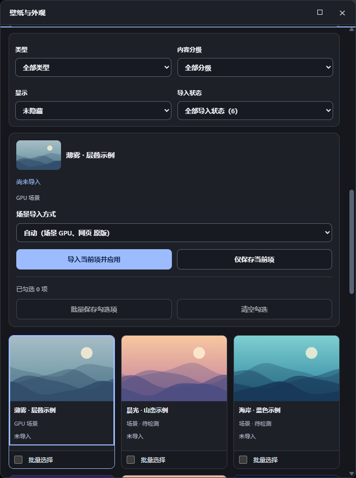
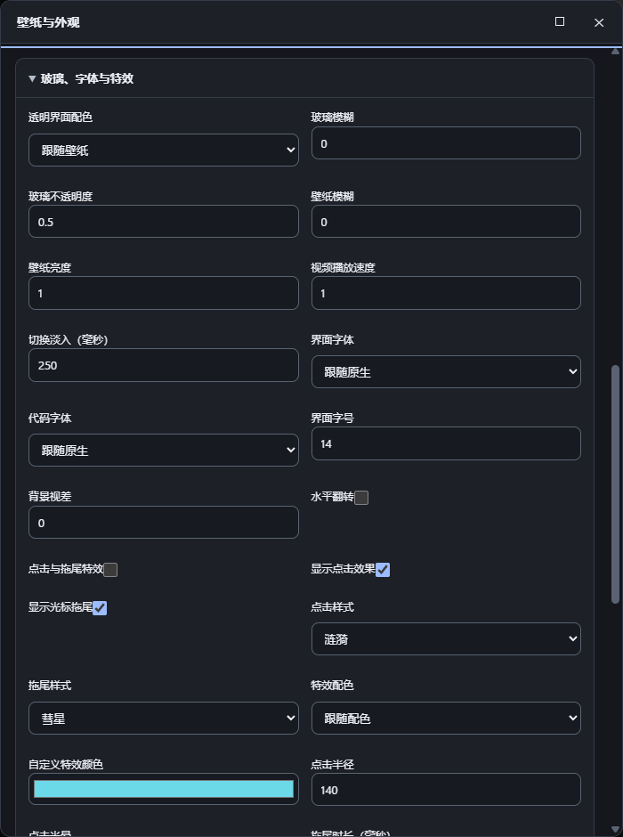
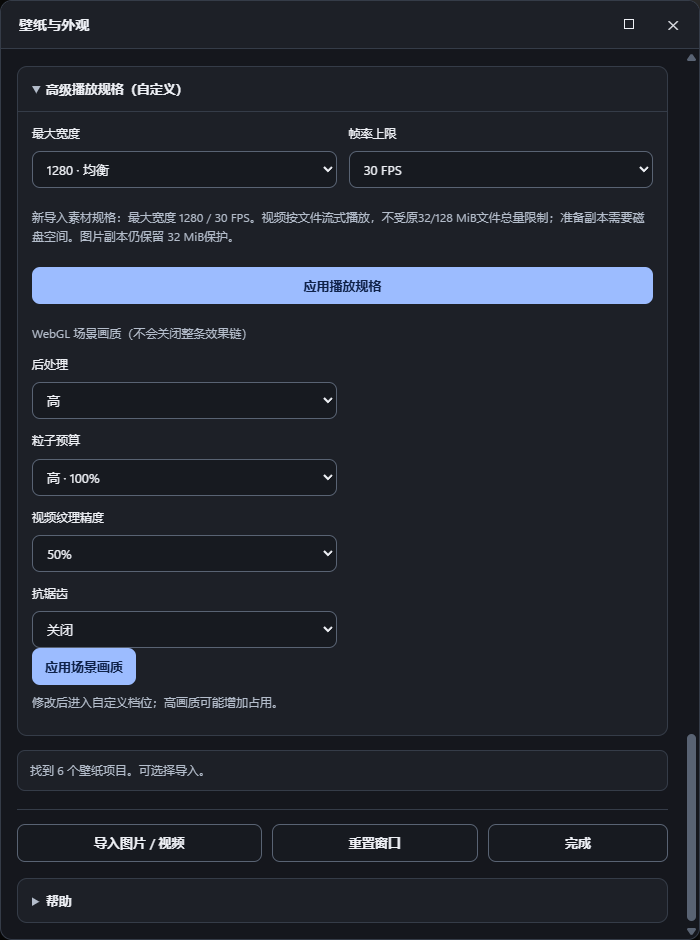
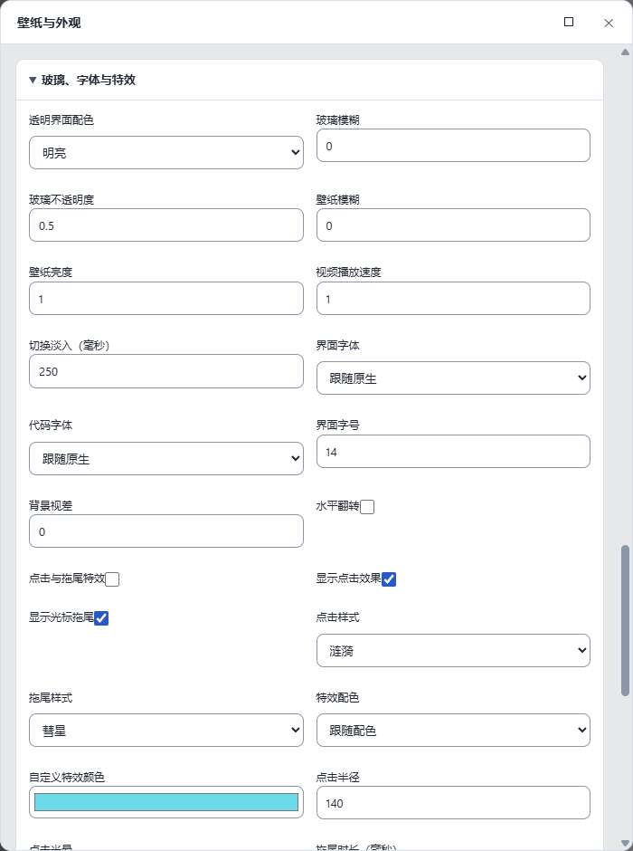
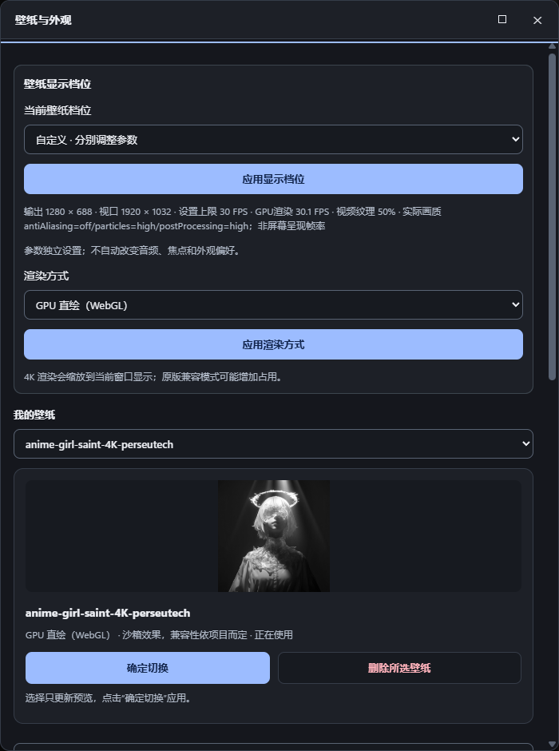
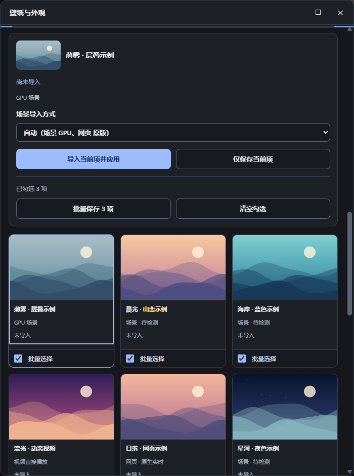
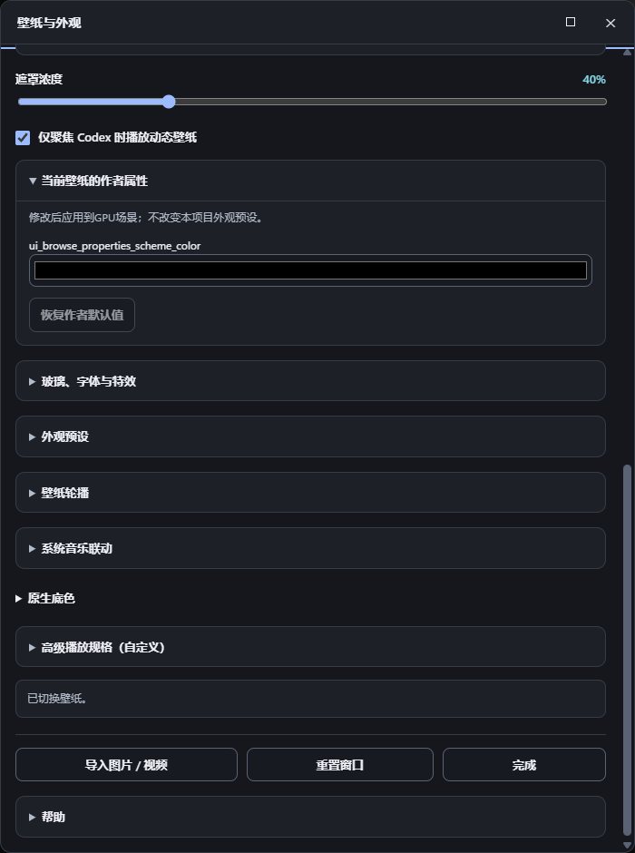
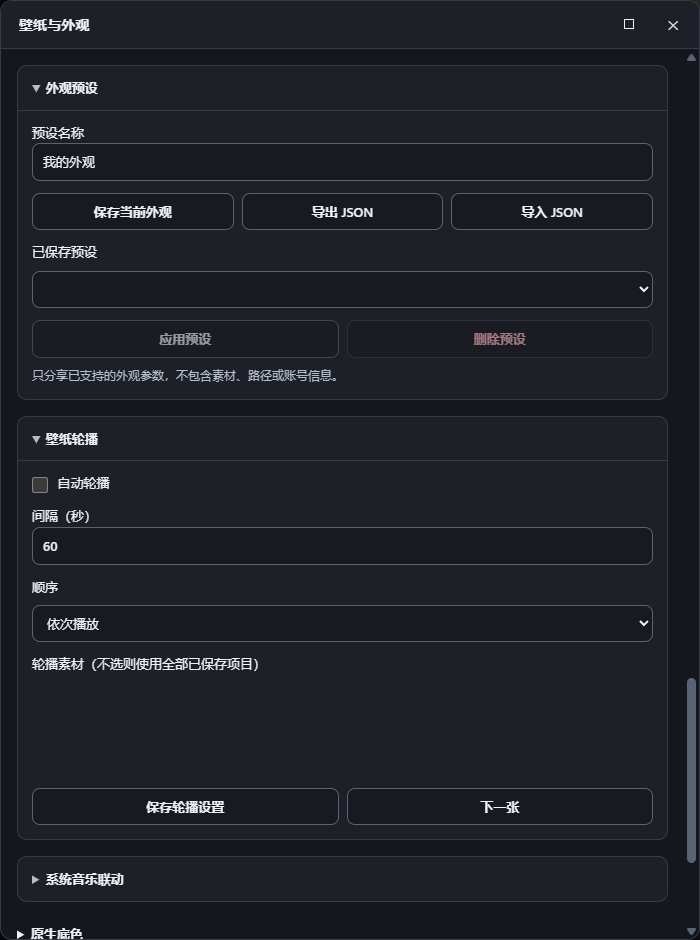
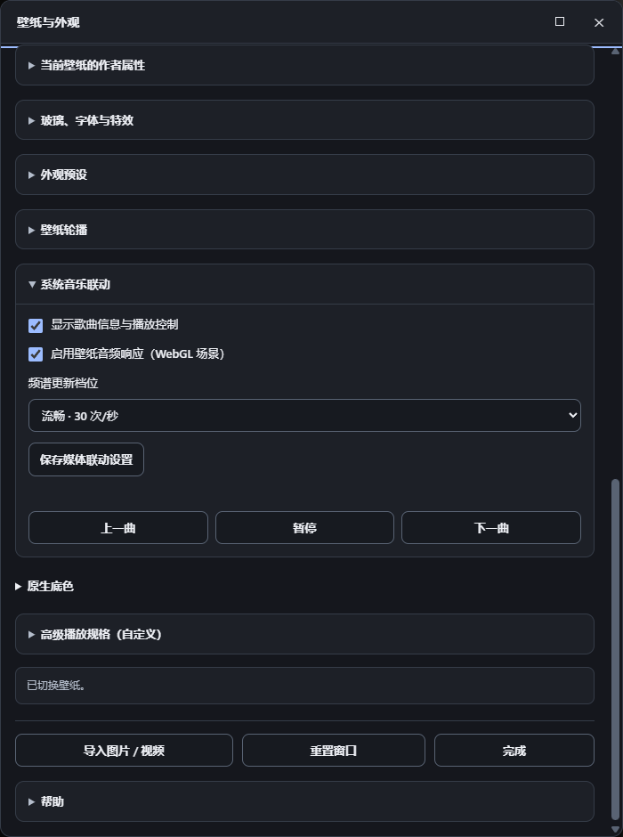
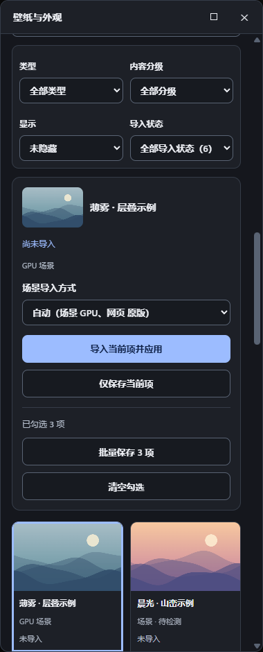

# Codex Wallpaper Bridge

[English](README.en.md)

为 Windows Codex 桌面客户端添加静态与动态壁纸，在客户端内切换素材、搜索 Wallpaper Engine 库、调整播放规格。

**本地壁纸 · 一体入口 · 内嵌控制面板 · 可选 GPU 场景**

[为什么选择它](#为什么选择它) · [效果展示](#效果展示) · [安装](#安装) · [首次使用](#首次使用) · [配置](#怎么配置) · [文档](#相关文档)


这是独立社区项目，通过本机 Chromium 调试接口接入 Codex，不是 OpenAI 官方插件。

## 为什么选择它

- **日常只用一个入口**：可新建 Codex Wallpaper 专用入口，也可备份后替换原 Codex 快捷方式；同一个入口启动客户端与壁纸，无需额外打开控制台或第二个控制程序。
- **直接在 Codex 里管理**：搜索、缩略预览、导入、批量保存和切换都在内嵌面板完成；图片、视频、GPU 场景和原版兼容项目统一管理。
- **场景可以直接走 GPU**：WebGL 模式在沙箱中渲染，避免每帧经过采集传输；需要原引擎效果时可切换原版兼容。
- **减少重复加载**：缓存未变化的素材、指纹和缩略图；同规格视频不重复转换，大视频按文件读取，场景就绪后再替换当前背景。
- **壁纸与阅读效果一起调整**：自动取色，分别调整聊天与输入区域遮罩，提供玻璃、字体、视差、点击拖尾、预设和轮播。
- **保留自己的素材**：删除库项只清理本项目管理的副本，保留工坊与外部原文件；支持完整库备份恢复。
- **安装后可移走下载目录**：双击安装器会部署独立程序副本、准备依赖并创建快捷方式，后续升级保留壁纸库和设置。

## 功能一览

| 功能 | 支持内容 |
| --- | --- |
| 本地素材 | JPG、PNG、WebP、GIF、MP4、WebM；单项导入并应用、仅保存、批量保存 |
| Wallpaper Engine | 搜索工坊/内置/自建项目，类型、分级、隐藏和导入状态筛选 |
| 场景与网页 | 沙箱 GPU 场景、原版兼容，以及可选网页浏览器模式 |
| 播放与画质 | 分辨率、FPS、4K 输出、后台暂停、场景画质与作者属性 |
| 外观 | 自动取色、遮罩、玻璃、字体、视差、点击与拖尾特效 |
| 管理 | 轮播、外观预设导入导出、完整库备份恢复与路径重定位 |
| 音乐 | 可选歌曲信息、播放控制与 GPU 场景音频响应 |

## 效果展示

以下均为**真实 Codex 桌面端实拍**；完整 [11 张图片索引与采集说明](docs/SCREENSHOTS.zh-CN.md)。

<table>
<tr><td width="50%"><b>图库与导入状态</b><br></td><td width="50%"><b>外观与特效</b><br></td></tr>
<tr><td><b>播放规格与场景画质</b><br></td><td><b>明亮主题</b><br></td></tr>
</table>

<details>
<summary>更多实拍：壁纸库、批量选择、作者属性、预设轮播、音乐联动与窄面板</summary>

| 壁纸库与当前运行方式 | 批量选择与保存入口 |
| --- | --- |
|  |  |

| 作者属性 | 外观预设与轮播 |
| --- | --- |
|  |  |

| 系统音乐联动 | 窄面板布局 |
| --- | --- |
|  |  |

</details>

演示壁纸来源：[anime-girl-saint-4K-perseutech](https://steamcommunity.com/sharedfiles/filedetails/?id=3552392736)，工坊上传者 **perseu**。图片只展示客户端效果，不提供原壁纸文件；壁纸与客户端品牌的权利归各自权利人，不随本项目代码许可重新授权。

### 选择哪种运行方式

| 素材 | 优先方式 | 取舍 |
| --- | --- | --- |
| 图片 / 视频 | 媒体播放 | 视频按文件读取，不因几百 MB 或数 GB 的文件大小整段装入内存；仍受解码能力和磁盘空间限制 |
| Wallpaper Engine 场景 | GPU 场景 | 在沙箱中直接渲染，避免逐帧采集传输；效果兼容性取决于素材 |
| Wallpaper Engine 网页 | 原版兼容 | 默认保留原引擎效果；有采集开销和延迟 |
| 本地网页 | 网页浏览器（试验） | 使用 Chrome/Edge 加载本地资源和部分作者 API，暂停时释放浏览器，恢复时重新加载 |

GPU 不能保证兼容任意场景；打包场景、图片副本及单次资源读取仍有各自预算。详见[大文件支持范围](docs/LARGE-MEDIA-20261027.zh-CN.md)。

## 加载与更新

通过素材指纹、缩略图和场景资源缓存复用未变化的数据，减少重复读取与转换。场景先交付渲染，再异步写入磁盘缓存；视频按文件读取，减少临时内存副本。

启动入口会重新识别当前注册的 Codex 安装包。可选安装一次性更新重连规则，在后续更新事件尝试一次正常恢复，不强制终止客户端、不增加自有常驻监控。见[更新重连说明](docs/AFTER-UPDATE-RECONNECT.zh-CN.md)。

### 更新后壁纸消失，怎么手动恢复

1. 先点击安装时选择的壁纸入口，让它重新检查并接入。
2. 若仍未恢复，保存工作并通过应用菜单**正常退出 Codex**，包括仍在后台的实例。
3. 按 `Win + R`，输入 `%LOCALAPPDATA%\CodexWallpaperBridge\Repair.cmd`，按提示重新打开。自定义安装时使用对应目录里的 `Repair.cmd`；同目录的 `CodexEntry.exe` 也可直接运行。
4. 若提示安装文件或依赖缺失，重新运行本项目安装包，选择原来的数据目录。

手动入口不受自动更新任务“只尝试一次”的限制，不清空壁纸库和设置。详细处理见[手动恢复指南](docs/INSTALL.zh-CN.md#更新后壁纸消失手动恢复)。

## 安装

**准备：Windows 10/11 x64，已安装并登录官方 Microsoft Store 版 Codex，保持联网。**

### 命令行一键安装

打开 **PowerShell**，复制执行：

```powershell
irm 'https://github.com/still12281/codex-wallpaper-bridge/releases/download/v0.1.0-alpha.0/install.ps1' | iex
```

自动下载 **v0.1.0-alpha.0** 安装包、核对 SHA-256、解压并开始安装。按提示选择新建专用入口或备份替换原快捷方式，以及是否启用更新后一次重连。不需要 Git，也不用先手动下载 ZIP；Windows 自带 PowerShell 和 PowerShell 7 均可运行。

安装成功后，保存工作并正常退出原 Codex，再打开所选壁纸入口。安装器不会自动关闭当前客户端。无法连接 GitHub 时使用下方手动下载方式。

### 下载安装包

1. 从本仓库的 [Releases](https://github.com/still12281/codex-wallpaper-bridge/releases) 下载固定版本的 `CodexWallpaperBridge-*.zip` 安装包，解压到本地文件夹。对应 `.sha256` 文件用于核对下载完整性。
2. 双击 **[`Install.cmd`](Install.cmd)**。选择 **1：新建 Codex Wallpaper 专用入口**，或 **2：备份并替换识别到的原 Codex 快捷方式**。
3. 按提示选择是否启用更新后一次重连；等待绿色 **Installed** 提示。依赖安装弹出 Windows 授权时，按提示确认。
4. 保存工作并正常退出原来的 Codex，再从所选入口打开。任务栏需要手动取消旧固定项并固定新的入口。

安装器自动检测并准备 **PowerShell 7、Node.js 22+、FFmpeg、uv、GPU 运行时和原版采集依赖**，复制程序到独立安装目录，生成带官方图标的桌面/开始菜单入口。不需要 Git、npm install 或手动编辑配置。首次下载依赖需要时间，安装器不会自动关闭或重启正在运行的 Codex。

替换模式只处理当前用户桌面/开始菜单中经过路径或 Store 应用身份确认的 `.lnk`，保留原名并保存原文件备份；没有可替换文件时创建桌面 `Codex` 快捷方式。不改 Store 注册入口或任务栏固定数据。专用模式会保留原入口，后续启动也不会自动替换它。

更新重连仅在后续 Codex 更新后尝试一次正常恢复，不强制结束、不增加自有常驻监控。升级安装默认沿用已保存的快捷方式模式和现有更新任务。自定义安装盘见[安装指南](docs/INSTALL.zh-CN.md#更换安装盘)。

| 你想使用什么 | 还需要安装什么 |
| --- | --- |
| 普通图片 / 视频 | 无，安装器已准备基础依赖 |
| Wallpaper Engine 壁纸库 / 原版兼容 | Steam 中的 Wallpaper Engine，并至少运行一次 |
| 网页浏览器（试验） | 本机 Chrome 或 Edge |
| 系统音乐联动 | 按[安装指南](docs/INSTALL.zh-CN.md#可选系统音乐和音频响应)准备可选音乐组件 |

安装默认位于 `%LOCALAPPDATA%\CodexWallpaperBridge`。安装成功后，下载的 ZIP 和解压目录可以移走；远程安装下载缓存的位置会在终端输出。升级时运行新版本对应的一键命令或安装包，壁纸库与设置会保留。找不到 WinGet 时，先在 Microsoft Store 安装/更新 **App Installer（应用安装程序）**。

**[完整安装指南：自定义安装盘、手动安装、依赖路径、故障处理、升级和卸载](docs/INSTALL.zh-CN.md)** · [隐私](PRIVACY.md) · [安全](SECURITY.md)

## 首次使用

1. 从安装时选择的壁纸入口进入客户端，点击顶部 **壁纸**。
2. **导入自己的图片/视频**：点击 **导入图片 / 视频**，选择本地素材。
3. **导入 Wallpaper Engine 项目**：点击 **搜索 Wallpaper 壁纸 / 图片 / 视频**；默认搜索已发现的壁纸库。找不到项目时，改选 **自选文件夹**，选择项目目录或上级库目录。
4. 点击缩略图后，选 **导入当前项并应用**，或 **仅保存当前项**。勾选多张后可 **批量保存**，不打断当前背景。
5. 在 **我的壁纸** 中选择项目预览，点击 **确定切换** 才应用。删除只清理库记录及本项目副本，保留外部原文件。

## 怎么配置

日常设置全部在壁纸面板内完成，修改后保存；不需要编辑 JSON。

| 想调整什么 | 在哪里设置 |
| --- | --- |
| 清晰度和流畅度 | 显示档位 / 高级播放规格：分辨率、FPS；初次使用可从默认 1280 宽、24 FPS 开始 |
| GPU 或原引擎 | 渲染方式：GPU 场景适合直接渲染；原版兼容使用 Wallpaper Engine |
| 透明度与可读性 | 遮罩、玻璃与字体：分别调整聊天区、输入区、背景亮度、字体和字号 |
| 壁纸自带的选项 | 当前壁纸的作者属性 |
| 点击、拖尾和视差 | 玻璃、字体与特效 |
| 定时切换 | 壁纸轮播：间隔、顺序和素材 |
| 保存一套外观 | 外观预设：保存、应用、导入/导出 JSON |
| 歌曲显示和音频响应 | 准备音乐组件后，在系统音乐联动中启用并保存 |

4K 档输出为 3840×2160。更高分辨率和帧率会增加 CPU/GPU 占用；视频不会凭空增加原素材的清晰度或帧率。完整库备份、恢复和卸载见[本地维护](docs/MAINTENANCE.zh-CN.md)。

## 相关文档

- [完整安装与配置指南](docs/INSTALL.zh-CN.md)
- [配置说明](docs/CONFIGURATION.md)
- [本地备份、恢复与卸载](docs/MAINTENANCE.zh-CN.md)
- [GPU 场景](docs/WEBWALLGL.md) · [原版兼容](docs/REALTIME.md) · [网页浏览器](docs/BROWSER-WEB-20261027.zh-CN.md)
- [系统音乐联动](docs/SYSTEM-MEDIA.md)
- [第三方来源与许可](THIRD_PARTY_NOTICES.md)

## 开发

直接从源码运行时，先准备依赖和渲染组件，再执行 `windows/Build-Launcher.ps1` 与 `windows/Prepare-TaskbarEntry.ps1`；一键安装器已包含这些步骤。源码路径变动后需重建直接构建的入口。已通过一体入口开启本机 CDP 会话时，可用 `npm start` 重接宿主；调试端口保持在 loopback 9335。

```powershell
npm test
npm run check:privacy
npm run test:integration # 可选，需要 Chrome/Chromium 和 FFmpeg
```

测试使用合成素材与隔离页面，不读取真实聊天/账号配置，不自动连接正在运行的 Codex。

## 许可与致谢

原创代码许可见 [LICENSE](LICENSE)，上游版权与许可证见 [THIRD_PARTY_NOTICES.md](THIRD_PARTY_NOTICES.md)。壁纸素材、商业客户端和品牌资产不属于本项目的代码许可范围。
