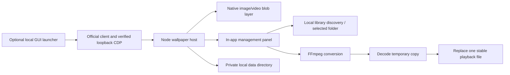

# Architecture

The host injects an isolated shadow-root media layer and controls, then applies scoped surface styles. Media bytes are transferred over local CDP into a blob; no local HTTP media server, CSP bypass, or modified client package is used. Native conversation/input nodes remain owned by the client.

The UI sends token-bearing actions through a Runtime binding. Searches issue server-side path tokens; imports verify canonical paths. Image/video decoding must succeed before replacing a playback copy. Deletion checks references and only unlinks eligible media files within the data root's `media` or `staging` directory.

The current single-video scene extraction path uses vendored container/texture parsers; scripts and renderer effects are not executed. Dependencies are resolved at runtime rather than using a developer's filesystem. The Node host has no production npm dependency installation step.

Data and source are separate. Generated profile, media, settings, status, logs, launcher and icon live in the private data directory. The public host never automatically captures a screenshot. To contribute debugging evidence, produce a synthetic example rather than copying real client state.
